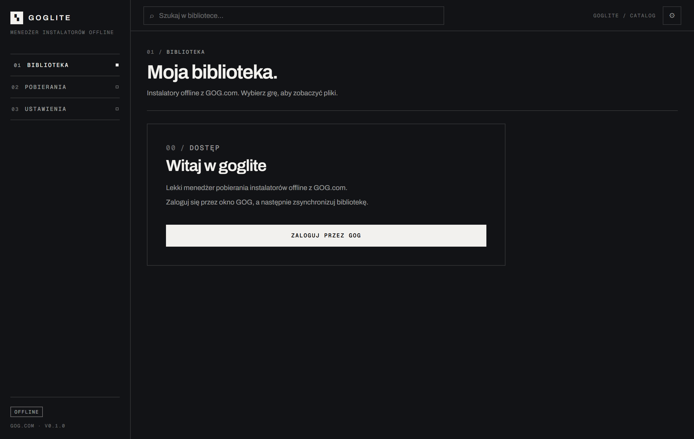
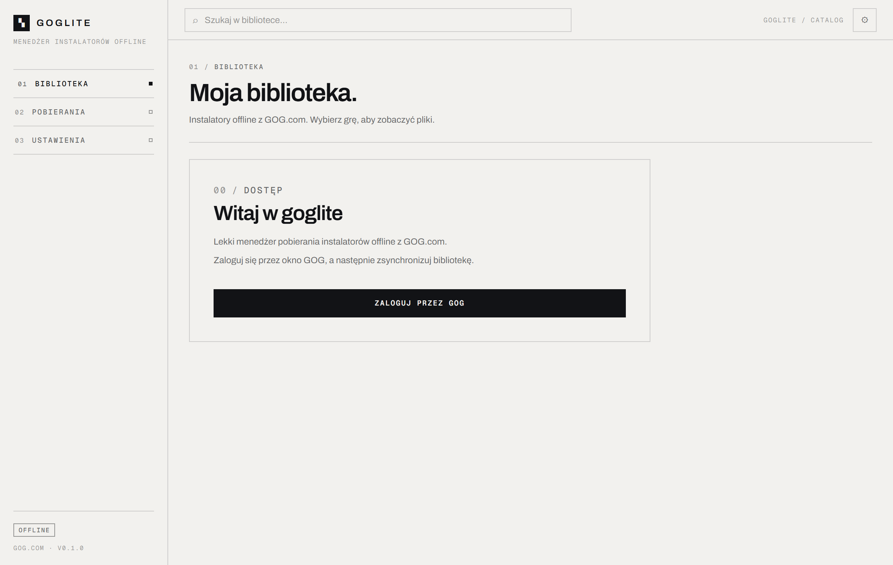
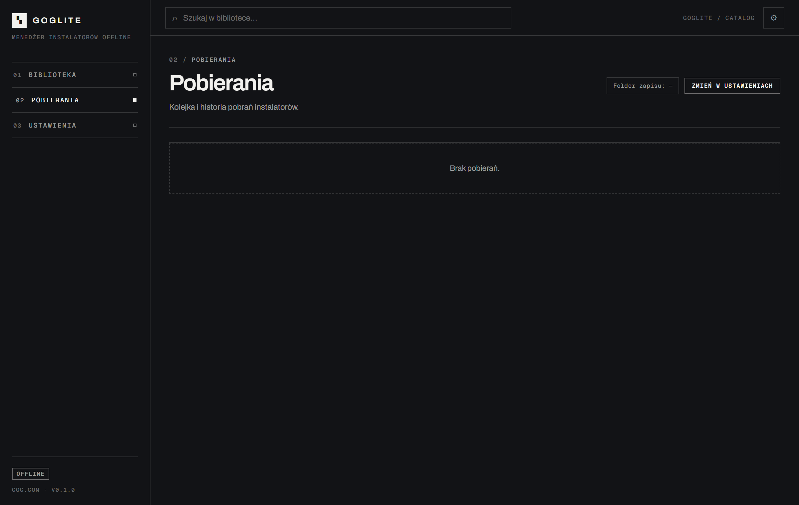
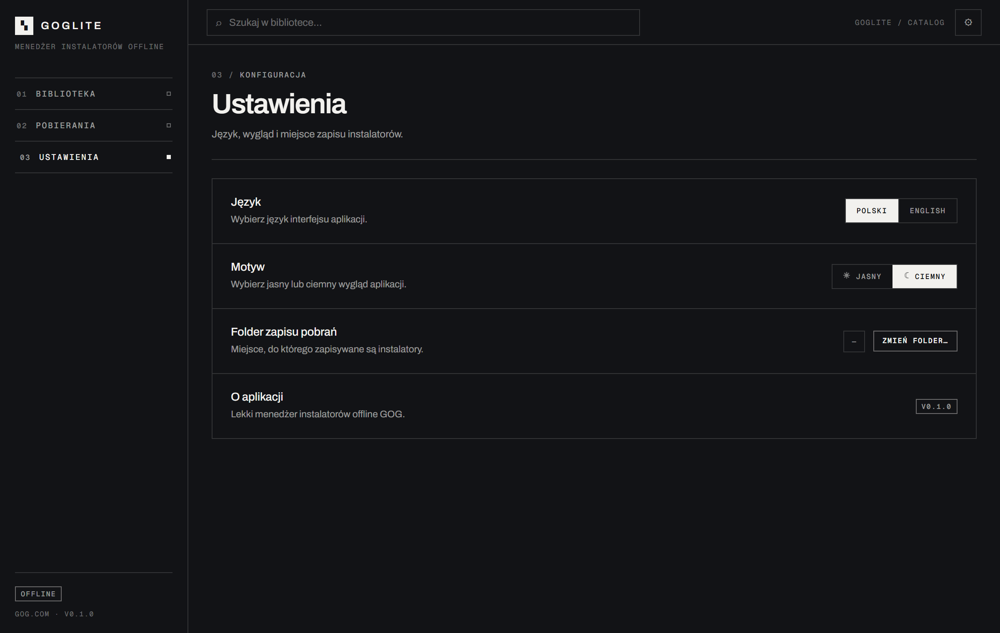
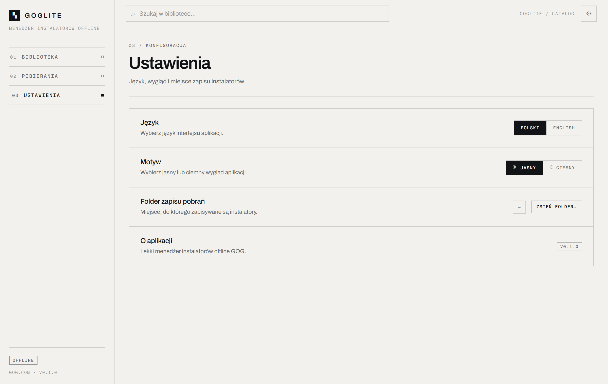

# goglite

[Polski](README.md) · **English**

A small desktop app (Tauri 2 + Rust) for browsing your **GOG.com** library and downloading offline
installers. Sign in through a GOG window, sync the library and pull installer files to disk —
no Galaxy client required.



*Screenshots come from the UI preview without a signed-in GOG account, so the library and the
download queue are empty.*

## Features

- **GOG sign-in** in a separate window (OAuth 2.0 authorization code flow) with token refresh.
- **Game library** with covers, genre, release date and supported platforms — every game
  (GOG, Prime Gaming, Epic Games) in one place, with store and platform filters.
- **A dedicated GOG view** (next to Prime Gaming and Epic Games): account, library, installers,
  direct install and launching.
- **Search** and a **platform filter** (All / Windows / Linux / macOS).
- **Game details**: description, developers, publishers, genres, screenshots with a zoom viewer.
- **Installers** per game, filtered by operating system; download queue with progress, pause
  and cancel.
- **Install and play right from the app** — a downloaded GOG installer can run silently
  (no wizard), and the installed game can be launched with the **Launch** button.
- **Two themes** (dark/light) and **two languages** (Polish/English) — applied instantly and
  stored in settings.
- **A separate folder per game** — chosen on the first download; the app checks whether the
  files are still on disk and marks each game as downloaded or downloading.
- **Prime Gaming (Amazon Games)** — Amazon sign-in, the library from the Amazon Games client,
  downloading into a chosen folder and launching, handled by
  [`nile`](https://github.com/imLinguin/nile).
- **Epic Games** — Epic sign-in, the library from the Epic Games Store (with cover art),
  downloads into a folder of your choice and launching; powered by
  [`legendary`](https://github.com/legendary-gl/legendary).
- **Install size** — Prime Gaming and Epic download rows show the downloaded and total size
  (e.g. `3.2 GiB / 24.0 GiB`), just like GOG downloads.

## Screenshots

| Library (light) | Downloads |
| --- | --- |
|  |  |

| Settings (dark) | Settings (light) |
| --- | --- |
|  |  |

## Requirements

- **Node.js** ≥ 20 and **Rust** ≥ 1.75 ([rustup](https://rustup.rs))
- **Windows:** MSVC Build Tools and WebView2 (preinstalled on Windows 10/11)
- **Amazon Games (optional):** [`nile`](https://github.com/imLinguin/nile) —
  the app installs it with one button in the Prime Gaming tab (via `winget`, no terminal).
  Manual: `winget install --id imLinguin.nile`.
- **Epic Games (optional):** [`legendary`](https://github.com/legendary-gl/legendary) —
  the app installs it with one button in the Epic Games tab (via `winget`, no terminal).
  Manual: `winget install --id derrod.legendary`.
- **Linux:** `libwebkit2gtk-4.1-dev`, `libgtk-3-dev`, `libayatana-appindicator3-dev`, `librsvg2-dev`,
  `build-essential`
- **macOS:** Xcode Command Line Tools

## Running

```bash
npm install
npm run tauri dev
```

`npm run dev` alone only serves the frontend in a browser (Vite, port 1420) — without the Rust
backend there is no sign-in, library or downloading.

## Building

```bash
npm run tauri build
```

Artifacts land in `src-tauri/target/release/bundle/`:

- **Windows** — `msi/goglite_0.1.0_x64_en-US.msi` and `nsis/goglite_0.1.0_x64-setup.exe`
- **Linux** — AppImage and `.deb` (requires the GTK/WebKit packages listed above)

## How sign-in works

1. **Sign in with GOG** calls the `login_via_www` command, which opens a dedicated window at
   `https://auth.gog.com/auth?...&response_type=code&layout=client2`.
2. After signing in, GOG redirects to `https://embed.gog.com/on_login_success?origin=client&code=…`.
   The app intercepts that navigation, closes the window and never loads the blank page.
3. The authorization code is exchanged for a token at `https://auth.gog.com/token`
   (the GOG Galaxy `client_secret` is required).
4. The token and `refresh_token` are stored in `auth.json`, which gets `600` permissions on Unix.
   The token is refreshed before it expires (60 s margin).

> The sign-in window is created on the event loop from a worker thread. Creating WebView2 while
> handling an IPC call made `build()` hang and left the window blank.

## Data on disk

Application data directory (`dirs::data_dir()/goglite`):

| OS | Path |
| --- | --- |
| Windows | `%APPDATA%\goglite\` |
| Linux | `~/.local/share/goglite/` |
| macOS | `~/Library/Application Support/goglite/` |

Files: `goglite.db` (SQLite), `auth.json`, `settings.json`.

Each game can use its own download folder (**Installers** tab → **Change folder…**).
Downloads go to the system *Downloads* folder by default, and it can be changed in **Settings**;
the `GOGLITE_DOWNLOAD_DIR` environment variable takes precedence over the stored setting.

## Project layout

```
goglite/
├── index.html                  # UI shell
├── vite.config.js              # Vite (port 1420)
├── src/
│   ├── main.js                 # UI logic: invoke, listen, render
│   ├── i18n.js                 # PL/EN dictionaries
│   ├── styles.css              # Dark/light themes (CSS variables)
│   └── fonts/                  # Archivo + Geist Mono (local, offline)
├── src-tauri/
│   ├── tauri.conf.json         # Window, bundle, icons
│   ├── sql/schema.sql          # SQLite schema
│   └── src/
│       ├── main.rs             # Entry point
│       ├── lib.rs              # Tauri init, app state
│       ├── auth.rs             # OAuth, token, sign-in window
│       ├── gog.rs              # GOG API client
│       ├── db.rs               # SQLite operations
│       ├── downloads.rs        # Download manager
│       ├── settings.rs         # Persisted settings
│       ├── platform.rs         # OS detection
│       ├── commands.rs         # IPC commands
│       └── error.rs            # Error types
├── scripts/gen_icon.py         # Icon generator
└── docs/screenshots/           # README screenshots
```

## IPC commands

| Command | Description |
| --- | --- |
| `get_auth_status` | Whether the user is signed in |
| `login_via_www` | Opens the GOG sign-in window |
| `logout` | Clears the stored token |
| `sync_library` | Fetches the GOG library and stores it locally |
| `get_games` | Games from the local database |
| `get_installers` | Installers for a game |
| `get_game_details` | Description, developers, publishers, genres, screenshots |
| `start_download` | Queues an installer |
| `pause_download`, `cancel_download` | Pause / cancel a download |
| `get_downloads` | Download queue and history |
| `get_download_dir`, `pick_download_dir` | Read and choose the download folder |
| `pick_game_dir` | Choose the download folder for a single game |
| `open_folder` | Open a folder (or the folder containing a file) in the system file manager |
| `gog_install` | Silent install from a downloaded GOG installer (returns the exe path) |
| `gog_launch` | Launches a GOG game installed from the app |
| `amazon_status` | Whether `nile` is available and the Amazon account is signed in |
| `amazon_login`, `amazon_login_complete`, `amazon_logout` | Amazon sign-in (start + finish with the redirect URL) and sign-out |
| `amazon_library`, `amazon_sync` | Amazon Games library (cached / forced refresh) |
| `amazon_install_nile` | Installs `nile` via winget (button in the Prime Gaming tab) |
| `pick_amazon_dir` | Choose the install folder for an Amazon game |
| `amazon_install`, `amazon_launch` | Download/install and launch an Amazon game |
| `epic_status` | Whether `legendary` is available and the Epic account is signed in |
| `epic_login`, `epic_login_complete`, `epic_logout` | Epic sign-in (start + finish with the code from the sign-in page) and sign-out |
| `epic_library`, `epic_sync` | Epic library (cached / forced metadata refresh) |
| `epic_install_legendary` | Installs `legendary` via winget (button in the Epic Games tab) |
| `pick_epic_dir` | Choose the install folder for an Epic game |
| `epic_install`, `epic_launch` | Download/install and launch an Epic game |
| `get_settings`, `set_language`, `set_theme` | Application settings |
| `detect_os` | OS and architecture |

Events emitted to the frontend: `auth:changed`, `auth:error`, `library:page`,
`download:progress`, `download:state`, `amazon:progress`, `amazon:done`,
`epic:progress`, `epic:done`, `epic:tool-progress`.

## Limitations

- GOG tokens expire after about an hour; the app refreshes them with the refresh token, and when
  that fails you have to sign in again.
- Every installer file is queued separately.
- The app relies on GOG's unofficial private API, so it may break if GOG changes it.
- Amazon Games works only through `nile` (Amazon has no public API). An Amazon account with
  games in the Amazon Games client is required; titles available only as keys for other stores
  are not handled here. Some games need Amazon services to launch.
- Epic works only through `legendary` (Epic has no public API for the library). The first
  library fetch can take a few minutes, and games that require EA App or Ubisoft Connect are
  skipped. Store downloads (Prime Gaming and Epic) share the Downloads tab.

## License

MIT. An educational project, not affiliated with GOG.com or CD Projekt.
