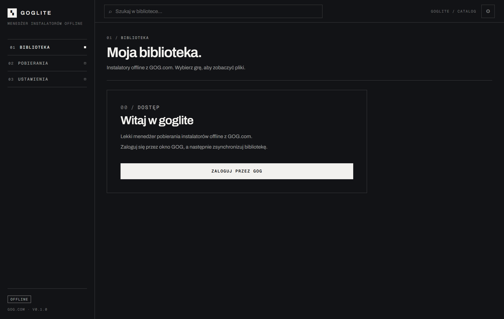
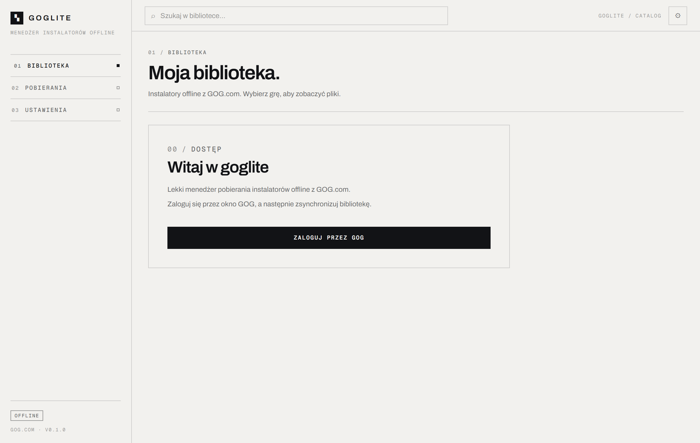
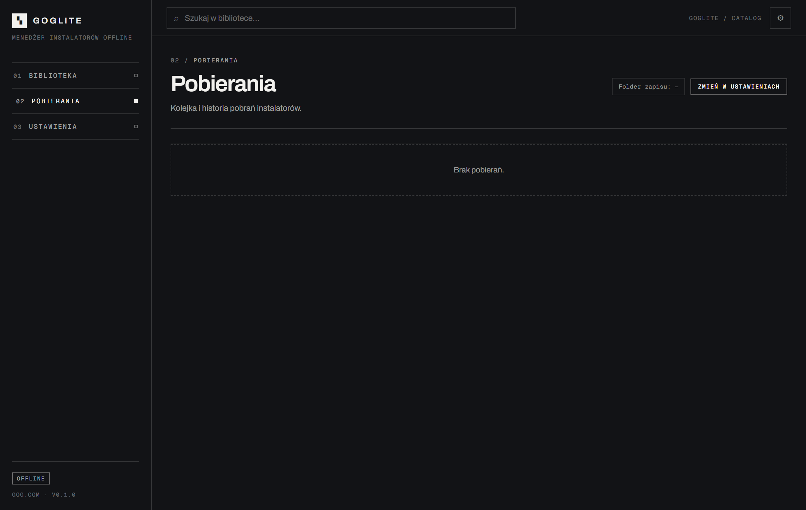
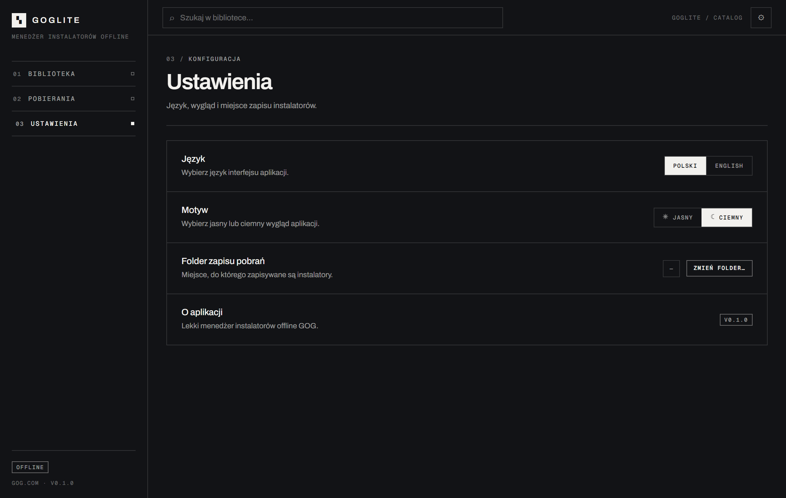
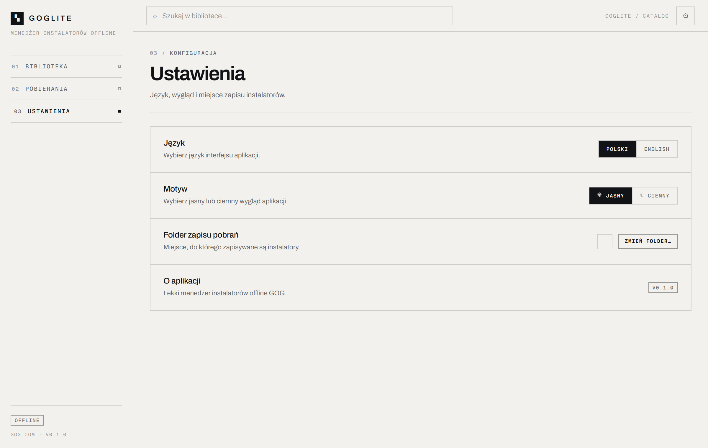

# goglite

**Polski** · [English](README.en.md)

Lekka aplikacja desktopowa (Tauri 2 + Rust) do przeglądania biblioteki **GOG.com** i pobierania
instalatorów offline. Logujesz się przez okno GOG, synchronizujesz bibliotekę i ściągasz pliki
instalacyjne na dysk — bez klienta Galaxy.



*Zrzuty ekranu pochodzą z podglądu interfejsu bez zalogowanego konta GOG, dlatego biblioteka
i kolejka pobrań są puste.*

## Funkcje

- **Logowanie przez GOG** w osobnym oknie (OAuth 2.0, Authorization Code) z odświeżaniem tokenu.
- **Biblioteka gier** z okładkami, gatunkiem, datą premiery i platformami.
- **Wyszukiwarka** i **filtr platformy** (Wszystkie / Windows / Linux / macOS).
- **Szczegóły gry**: opis, producent, wydawca, gatunki, zrzuty ekranu (podgląd w powiększeniu).
- **Instalatory** per gra, filtrowane po systemie; kolejka pobrań z postępem, wstrzymywaniem
  i anulowaniem.
- **Dwa motywy** (ciemny/jasny) i **dwa języki** (polski/angielski) — zmiana natychmiastowa,
  zapisywana w ustawieniach.
- **Wybór folderu zapisu** instalatorów.

## Zrzuty ekranu

| Biblioteka (jasny) | Pobierania |
| --- | --- |
|  |  |

| Ustawienia (ciemny) | Ustawienia (jasny) |
| --- | --- |
|  |  |

## Wymagania

- **Node.js** ≥ 20 i **Rust** ≥ 1.75 ([rustup](https://rustup.rs))
- **Windows:** MSVC Build Tools oraz WebView2 (w Windows 10/11 jest domyślnie)
- **Linux:** `libwebkit2gtk-4.1-dev`, `libgtk-3-dev`, `libayatana-appindicator3-dev`, `librsvg2-dev`,
  `build-essential`
- **macOS:** Xcode Command Line Tools

## Uruchomienie

```bash
npm install
npm run tauri dev
```

Sam `npm run dev` uruchamia tylko frontend w przeglądarce (Vite, port 1420) — bez backendu Rust
nie ma logowania, biblioteki ani pobierań.

## Budowanie

```bash
npm run tauri build
```

Artefakty trafiają do `src-tauri/target/release/bundle/`:

- **Windows** — `msi/goglite_0.1.0_x64_en-US.msi` oraz `nsis/goglite_0.1.0_x64-setup.exe`
- **Linux** — AppImage i `.deb` (wymagają zależności GTK/WebKit wymienionych wyżej)

## Jak działa logowanie

1. Przycisk **Zaloguj przez GOG** wywołuje komendę `login_via_www`, która otwiera osobne okno
   z `https://auth.gog.com/auth?...&response_type=code&layout=client2`.
2. Po zalogowaniu GOG przekierowuje na `https://embed.gog.com/on_login_success?origin=client&code=…`.
   Aplikacja przechwytuje tę nawigację, zamyka okno i nie ładuje białej strony.
3. Kod autoryzacyjny jest wymieniany na token pod `https://auth.gog.com/token`
   (wymagany `client_secret` klienta GOG Galaxy).
4. Token i `refresh_token` lądują w `auth.json`; na Unixie plik dostaje uprawnienia `600`.
   Token jest odświeżany, zanim wygaśnie (margines 60 s).

> Okno logowania jest tworzone na pętli zdarzeń z osobnego wątku. Utworzenie WebView2 w trakcie
> obsługi IPC zawieszało `build()` i dawało białe okno.

## Dane na dysku

Katalog danych aplikacji (`dirs::data_dir()/goglite`):

| System | Ścieżka |
| --- | --- |
| Windows | `%APPDATA%\goglite\` |
| Linux | `~/.local/share/goglite/` |
| macOS | `~/Library/Application Support/goglite/` |

Pliki: `goglite.db` (SQLite), `auth.json`, `settings.json`.

Domyślny folder pobrań to systemowy katalog „Pobrane”. Można go zmienić w **Ustawieniach**;
zmienna środowiskowa `GOGLITE_DOWNLOAD_DIR` ma pierwszeństwo przed zapisanym ustawieniem.

## Struktura projektu

```
goglite/
├── index.html                  # Szkielet interfejsu
├── vite.config.js              # Vite (port 1420)
├── src/
│   ├── main.js                 # Logika UI: invoke, listen, render
│   ├── i18n.js                 # Słowniki PL/EN
│   ├── styles.css              # Motywy ciemny/jasny (zmienne CSS)
│   └── fonts/                  # Archivo + Geist Mono (lokalnie, offline)
├── src-tauri/
│   ├── tauri.conf.json         # Okno, bundle, ikony
│   ├── sql/schema.sql          # Schemat SQLite
│   └── src/
│       ├── main.rs             # Punkt wejścia
│       ├── lib.rs              # Init Tauri, stan aplikacji
│       ├── auth.rs             # OAuth, token, okno logowania
│       ├── gog.rs              # Klient API GOG
│       ├── db.rs               # Operacje SQLite
│       ├── downloads.rs        # Menedżer pobierania
│       ├── settings.rs         # Trwałe ustawienia
│       ├── platform.rs         # Wykrywanie systemu
│       ├── commands.rs         # Komendy IPC
│       └── error.rs            # Typy błędów
├── scripts/gen_icon.py         # Generator ikony
└── docs/screenshots/           # Zrzuty do README
```

## Komendy IPC

| Komenda | Opis |
| --- | --- |
| `get_auth_status` | Czy użytkownik jest zalogowany |
| `login_via_www` | Otwiera okno logowania GOG |
| `logout` | Usuwa zapisany token |
| `sync_library` | Pobiera bibliotekę z GOG i zapisuje ją w bazie |
| `get_games` | Lista gier z bazy |
| `get_installers` | Instalatory wybranej gry |
| `get_game_details` | Opis, producent, wydawca, gatunki, zrzuty |
| `start_download` | Dodaje instalator do kolejki |
| `pause_download`, `cancel_download` | Wstrzymuje / anuluje pobieranie |
| `get_downloads` | Kolejka i historia pobrań |
| `get_download_dir`, `pick_download_dir` | Odczyt i wybór folderu zapisu |
| `get_settings`, `set_language`, `set_theme` | Ustawienia aplikacji |
| `detect_os` | System i architektura |

Zdarzenia emitowane do frontendu: `auth:changed`, `auth:error`, `library:page`,
`download:progress`, `download:state`.

## Ograniczenia

- Token GOG wygasa po około godzinie; aplikacja odświeża go tokenem odświeżania, a gdy to się nie
  uda, trzeba zalogować się ponownie.
- Każdy plik instalatora jest dodawany do kolejki osobno.
- Aplikacja korzysta z nieoficjalnego, prywatnego API GOG — może przestać działać, jeśli GOG je zmieni.

## Licencja

MIT. Projekt edukacyjny, niepowiązany z GOG.com ani CD Projekt.
